# Diagrama de Classes - PokeSal (Fase 03: Inversão de Dependências e Mockito)

**Projeto:** PokeSal - Simulador de Batalha (UCSal Pituaçu)  
**Notação:** Mermaid Class Diagram  
**Padrão Arquitetural:** Inversão de Dependência (DIP - SOLID) e Arquitetura em Camadas (Model, Service, Infra)

---

```mermaid
classDiagram
    direction TB

    %% ==========================================
    %% CAMADA DE INTERFACES (CONTRATOS DE SERVIÇO)
    %% ==========================================
    class GeradorAleatorio {
        <<interface>>
        +gerarDouble()* double
        +gerarInteiro(int limiteExclusivo)* int
        +gerarBooleano()* boolean
    }

    class ServicoTerreno {
        <<interface>>
        +obterModificadorDano(Terreno terreno, TipoElemental tipoGolpe, LocalDateTime horario)* double
        +obterTerrenoAtual(LocalDateTime horario)* Terreno
        +isEfeitoAtivo(Terreno terreno, LocalDateTime horario)* boolean
    }

    class RepositorioResultados {
        <<interface>>
        +salvar(ResultadoBatalha resultado)* void
        +listarTodos()* List~ResultadoBatalha~
    }

    class RegistroBatalha {
        <<interface>>
        +registrarAtaque(Treinador atacante, Treinador defensor, Golpe golpe)* void
        +registrarDano(Treinador atacante, Treinador defensor, int dano, boolean critico)* void
        +registrarEfeitoStatus(Pokesal alvo, TipoStatus status)* void
        +registrarEfeitoTerreno(Terreno terreno, Pokesal alvo)* void
        +registrarUsoItem(Treinador treinador, ItemDeBatalha item)* void
        +registrarFimDeBatalha(Treinador vencedor, Treinador perdedor, int turnos)* void
    }

    class ServicoTorcida {
        <<interface>>
        +aferirVibracao(Pokesal pokesal)* StatusTorcida
    }

    class ProcessadorDreno {
        <<interface>>
        +calcularCura(int danoCausado, double taxaDreno)* int
    }

    class ExecutorDeBatalha {
        <<interface>>
        +executar(Treinador t1, Treinador t2, Terreno terreno)* Batalha
    }

    %% ==========================================
    %% CAMADA DE IMPLEMENTAÇÕES DE INFRAESTRUTURA
    %% ==========================================
    class GeradorAleatorioPadrao {
        -Random random
        +gerarDouble() double
        +gerarInteiro(int limiteExclusivo) int
        +gerarBooleano() boolean
    }

    class ServicoTerrenoPadrao {
        -Clock clock
        -boolean chovendo
        +obterModificadorDano(Terreno terreno, TipoElemental tipoGolpe, LocalDateTime horario) double
        +obterTerrenoAtual(LocalDateTime horario) Terreno
        +isEfeitoAtivo(Terreno terreno, LocalDateTime horario) boolean
    }

    class RepositorioResultadosEmMemoria {
        -List~ResultadoBatalha~ registros
        +salvar(ResultadoBatalha resultado) void
        +listarTodos() List~ResultadoBatalha~
    }

    class RegistroBatalhaConsole {
        +registrarAtaque(Treinador atacante, Treinador defensor, Golpe golpe) void
        +registrarDano(Treinador atacante, Treinador defensor, int dano, boolean critico) void
        +registrarEfeitoStatus(Pokesal alvo, TipoStatus status) void
        +registrarEfeitoTerreno(Terreno terreno, Pokesal alvo) void
        +registrarUsoItem(Treinador treinador, ItemDeBatalha item) void
        +registrarFimDeBatalha(Treinador vencedor, Treinador perdedor, int turnos) void
    }

    class ServicoTorcidaPadrao {
        -GeradorAleatorio geradorAleatorio
        +aferirVibracao(Pokesal pokesal) StatusTorcida
    }

    class ProcessadorDrenoPadrao {
        +calcularCura(int danoCausado, double taxaDreno) int
    }

    class ExecutorDeBatalhaPadrao {
        -GeradorAleatorio geradorAleatorio
        -ServicoTerreno servicoTerreno
        -Clock clock
        -RepositorioResultados repositorioResultados
        -RegistroBatalha registroBatalha
        -ServicoTorcida servicoTorcida
        -ProcessadorDreno processadorDreno
        +executar(Treinador t1, Treinador t2, Terreno terreno) Batalha
    }

    GeradorAleatorio <|.. GeradorAleatorioPadrao : implementa
    ServicoTerreno <|.. ServicoTerrenoPadrao : implementa
    RepositorioResultados <|.. RepositorioResultadosEmMemoria : implementa
    RegistroBatalha <|.. RegistroBatalhaConsole : implementa
    ServicoTorcida <|.. ServicoTorcidaPadrao : implementa
    ProcessadorDreno <|.. ProcessadorDrenoPadrao : implementa
    ExecutorDeBatalha <|.. ExecutorDeBatalhaPadrao : implementa

    %% ==========================================
    %% CAMADA DE SERVIÇOS DE DOMÍNIO
    %% ==========================================
    class Batalha {
        -Treinador treinador1
        -Treinador treinador2
        -Terreno terreno
        -GeradorAleatorio geradorAleatorio
        -ServicoTerreno servicoTerreno
        -Clock clock
        -RepositorioResultados repositorioResultados
        -RegistroBatalha registroBatalha
        -ServicoTorcida servicoTorcida
        -ProcessadorDreno processadorDreno
        -int turnoDaBatalha
        -Treinador vencedor
        -boolean encerrada
        -List~String~ errosRegistrados
        +determinarPrimeiroAtacante() Treinador
        +calcularDano(Pokesal atacante, Pokesal defensor, Golpe golpe) int
        +executarAcaoDeAtaque(Treinador atacante, Treinador defensor, Golpe golpe) int
        +consumirItemNoTurno(Treinador treinador, int indiceItem) void
        +verificarHp(Treinador t1, Treinador t2) void
        +pontuarVencedor() void
    }

    class Torneio {
        -ExecutorDeBatalha executorDeBatalha
        -ServicoTerreno servicoTerreno
        -GeradorAleatorio geradorAleatorio
        -Clock clock
        +executarTorneio(List~Treinador~ participantes) Treinador
    }

    class SimuladorDeBatalha {
        -List~Treinador~ treinadores
        -GeradorAleatorio geradorAleatorio
        +cadastrarTreinadoresTorneio(int quantidade, String nomeJogador) void
        +sortearPokesal(Treinador treinador) void
        +sortearHeldItem(Treinador treinador) void
        +sortearTerreno() Terreno
    }

    %% ==========================================
    %% CAMADA DE MODELOS
    %% ==========================================
    class Pokesal {
        -String nome
        -int hpMax
        -int hpAtual
        -int atk
        -int def
        -int spd
        -TipoElemental tipoElemental
        -List~Golpe~ golpes
        -HeldItem heldItem
        -TipoStatus statusAtual
        -boolean vigorDePituacuAtivo
        +receberDano(int dano) void
        +curar(int qtd) void
        +ativarVigorDePituacu() void
        +consumirVigorDePituacu() boolean
        +processarEfeitosFimDeTurno() void
    }

    class Golpe {
        -String nome
        -int poder
        -TipoElemental tipo
        -int precisao
        -boolean isGolpeDreno
        -double taxaDreno
    }

    class Treinador {
        -String nome
        -Pokesal pokesal
        -List~ItemDeBatalha~ mochila
        -int contItensUsados
        -int batalhasVencidas
        +usarItem(int indice) void
        +incrementarBatalhasVencidas() void
    }

    class ResultadoBatalha {
        -Treinador vencedor
        -Treinador perdedor
        -int numeroTurnos
        -Pokesal pokesalVencedor
        -Pokesal pokesalPerdedor
        -boolean empate
        -LocalDateTime dataHoraFim
    }

    class StatusTorcida {
        <<enumeration>>
        EMPOLGADA
        NEUTRA
        VAIANDO
    }

    class TipoElemental {
        <<enumeration>>
        FOGO
        AGUA
        PLANTA
    }

    class TipoStatus {
        <<enumeration>>
        SAUDAVEL
        QUEIMADO
        ENVENENADO
        PARALISADO
    }

    %% ==========================================
    %% RELACIONAMENTOS DE DEPENDÊNCIA E COMPOSIÇÃO
    %% ==========================================
    Batalha --> GeradorAleatorio : depende (DIP)
    Batalha --> ServicoTerreno : depende (DIP)
    Batalha --> RepositorioResultados : depende (DIP)
    Batalha --> RegistroBatalha : depende (DIP)
    Batalha --> ServicoTorcida : depende (DIP / RA-F03-01)
    Batalha --> ProcessadorDreno : depende (DIP / RA-F03-02)
    Batalha o-- Treinador : competidores
    Batalha ..> ResultadoBatalha : produz

    Torneio --> ExecutorDeBatalha : orquestra (DIP)
    Torneio --> ServicoTerreno : consulta
    Torneio --> GeradorAleatorio : desempate
    Torneio o-- Treinador : participantes

    Treinador *-- Pokesal : parceiro
    Pokesal *-- Golpe : possui (3)
    Pokesal --> TipoElemental : tipagem
    Pokesal --> TipoStatus : status
    Golpe --> TipoElemental : elemento
    ServicoTorcida ..> StatusTorcida : avalia
```

