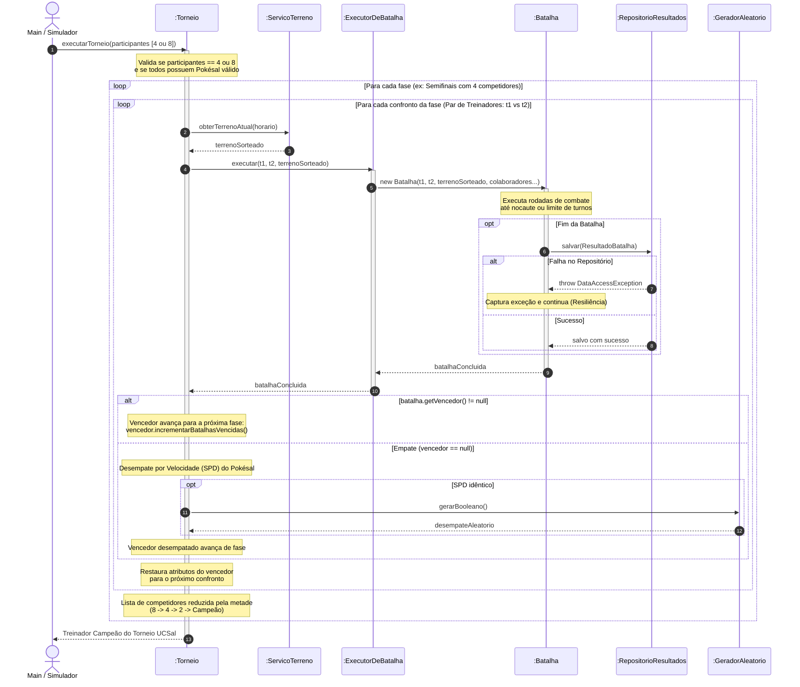

# Diagrama de Sequência - Chaveamento e Registro de Torneio (Fase 03)

**Projeto:** PokeSal - Simulador de Batalha (UCSal Pituaçu)  
**Notação:** Mermaid Sequence Diagram  
**Objetivo:** Demonstrar o fluxo de execução do chaveamento eliminatório (4 ou 8 competidores), orquestração de partidas via `ExecutorDeBatalha`, resolução de confrontos, avanço de vencedores e persistência resiliente no `RepositorioResultados`.

---

