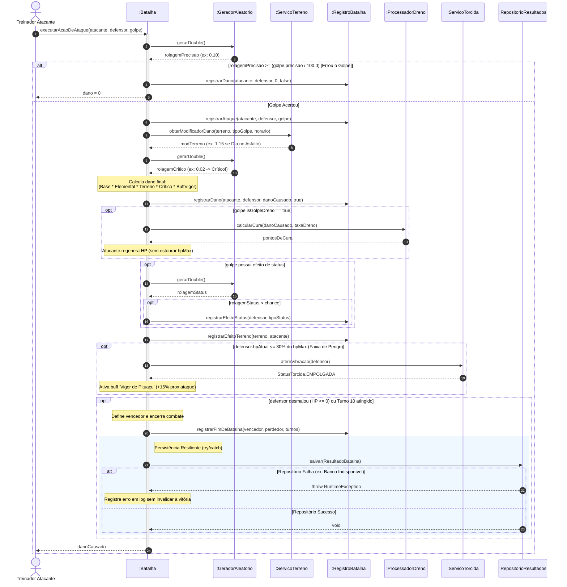

# Diagrama de Sequência - Turno Completo de Batalha (Fase 03)

**Projeto:** PokeSal - Simulador de Batalha (UCSal Pituaçu)  
**Notação:** Mermaid Sequence Diagram  
**Objetivo:** Demonstrar a orquestração e a ordem cronológica estrita de eventos em um turno de combate, destacando a consulta aos colaboradores mockáveis (`GeradorAleatorio`, `ServicoTerreno`, `RegistroBatalha`, `ProcessadorDreno`, `ServicoTorcida` e `RepositorioResultados`).

---

